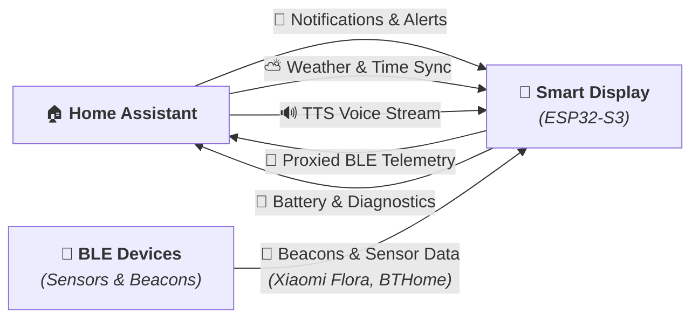
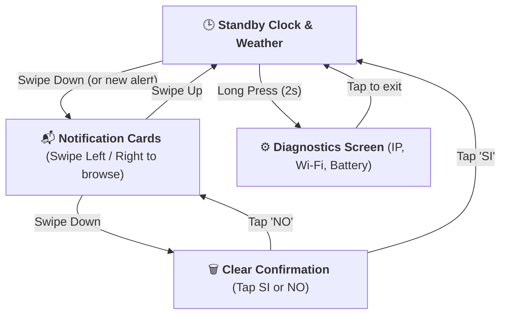

# 🔮 SmartDisplay ESP32-S3

[](https://github.com/pasmimmo/SmartDisplay/actions/workflows/ci.yml)
[](https://esphome.io)
[](https://home-assistant.io)
[](docs/ARCHITECTURE_DECISIONS.md)
[](CODE_OF_CONDUCT.md)
[](LICENSE)
[](https://it.aliexpress.com/item/1005008821384965.html)

**SmartDisplay** is a modern, modular, open-source firmware based on **ESPHome** and **LVGL 8** designed for the **SP-ESP32-S3-1.28-BOX** circular smart display. 

It repurposes the popular AliExpress [Xiaozhi AI desktop box](https://it.aliexpress.com/item/1005008821384965.html) (originally running cloud-locked firmware from [78/xiaozhi-esp32](https://github.com/78/xiaozhi-esp32)) into a **100% local, private, full-featured Home Assistant notification display, desktop clock, weather widget, and TTS voice announcement speaker**.

---

## 🗺️ System Overview & Architecture

High-level architecture connecting **Home Assistant**, the **Smart Display**, and nearby **Bluetooth Low Energy (BLE)** devices:



---

## ✨ Features

* **🎨 Smooth Circular UI (LVGL 8)**: Tailored specifically for the 240x240 GC9A01A round IPS display running at 80 MHz SPI bus with DMA acceleration.
* **📬 LIFO Notification Queue**: Stores up to 10 notifications in an interactive card carousel with Material Symbols icons and customizable text colors.
* **🔊 Voice Announcements (TTS & Media Player)**: Built-in ES8311 DAC + I2S speaker integrated with Home Assistant's `announcement_pipeline`.
* **⛅ Standby Clock + Live Weather**: Event-driven digital clock synchronized over SNTP + live outdoor condition icon and temperature fetched directly from Home Assistant.
* **🔔 Unread Notification Badge**: Subtle amber bell indicator above the clock when unread notifications are waiting in the queue.
* **⚡ Smart Power & Battery Management**:
  * Accurate battery level reporting with an ADC median filter (`GPIO1`).
  * Hardware charging detection (`GPIO41`).
  * Auto-sleep timer (default: 300s) turns off the screen **only** when running on battery; stays awake on desk when plugged in.
  * **Dynamic Audio Power Gating**: Automatically cuts amplifier power (`GPIO46`) in standby, saving **~20mA** and eliminating background hiss.
* **🎛️ Dimmable PWM Backlight**: 1kHz flicker-free LEDC control with smooth fade-in/fade-out transitions. Exposes a 1%–100% brightness slider in Home Assistant to easily dim the screen at night.
* **📡 Passive Bluetooth Proxy (Xiaomi Plant Sensors)**: Acts as a localized BLE proxy for Home Assistant. Ideal for capturing passive data from **Xiaomi Mi Flora / Flower Care plant sensors**, BTHome beacons, or BLE thermometers without connection overhead or audio stuttering.
* **👆 Natural Touch Gestures**: Browse history, toggle screen, open diagnostics, or clear notifications with intuitive swipes.

---

## 🛒 Hardware & Purchase Link

| Item | Details |
| :--- | :--- |
| **Product Link** | [AliExpress ESP32-S3 1.28" Display Box](https://it.aliexpress.com/item/1005008821384965.html) |
| **Original Stock FW** | [78/xiaozhi-esp32 (GitHub)](https://github.com/78/xiaozhi-esp32) |
| **SoC** | Espressif ESP32-S3 (8MB Octal PSRAM, 16MB Flash) |
| **Display** | 1.28-inch IPS Circular LCD (240x240, GC9A01A over SPI) |
| **Touchscreen** | CST816D capacitive touch (I2C) |
| **Audio DAC** | Everest ES8311 + onboard speaker amp |
| **Battery** | Internal rechargeable 1S LiPo + USB-C charging port |

> [!WARNING]
> **Hardware Revisions & Pinout Notice:** AliExpress vendors occasionally release revised PCB revisions or clones with slightly different GPIO pin assignments (e.g., audio amp enable or touch interrupt). The pinout documented here is verified for the **SP-ESP32-S3-1.28-BOX**. Always inspect your board's silkscreen markings or verify with your seller's schematic if a peripheral doesn't respond!

👉 For full pinout tables, schematics, and factory firmware backup instructions, see **[Hardware Reference](docs/HARDWARE.md)**.

---

## 🚀 Quickstart

Want to get running in under 3 minutes? Check our **[⚡ Lapidary Quickstart Guide](docs/QUICKSTART.md)** or the **[GitHub Wiki](https://github.com/pasmimmo/SmartDisplay/wiki)**!

### Installation via ESPHome Dashboard

1. In your Home Assistant ESPHome Dashboard, click **+ New Device**, name it `smartdisplay`, and skip the wizard.
2. Click **Edit** and paste the content of [`smartdisplay_standalone.yaml`](smartdisplay_standalone.yaml) (or use the modular [`packages/`](packages/) setup).
3. Set your parameters in `substitutions:` at the top:
   ```yaml
   substitutions:
     device_name: "smartdisplay"
     friendly_name: "SmartDisplay"
     timezone: "Europe/Rome"
     weather_entity: "weather.forecast_casa"
     sleep_timeout: "300s"
   ```
4. Put your Wi-Fi credentials into `secrets.yaml`:
   ```yaml
   wifi_ssid: "YOUR_WIFI_SSID"
   wifi_password: "YOUR_WIFI_PASSWORD"
   ```
5. Click **Install** -> **Plug into this computer** (or update **Wirelessly** if already running ESPHome).

---

## 🏠 Home Assistant Integration

### 1. Sending a Notification
Call the `esphome.<device_name>_send_notification` action from any automation or script:

```yaml
action: esphome.smartdisplay_send_notification
data:
  message: "Front door was unlocked!"
  icon: "lock_open"
  text_color: "orange"
  timeout: 30
```

#### Supported Notification Icons
| Icon Keyword | Material Symbol | Recommended Use |
| :--- | :---: | :--- |
| `notifications` | 🔔 | General notifications / reminders |
| `warning` | ⚠️ | Critical alarms, water leaks, faults |
| `info` | ℹ️ | Informational notices |
| `home` | 🏠 | Presence, welcome home, doorbell |
| `thermometer` | 🌡️ | Temperature alerts / climate |
| `window` | 🪟 | Window / door left open |
| `lightbulb` | 💡 | Lighting automation alerts |
| `lock` / `lock_open`| 🔒 / 🔓 | Door locks, alarm armed/disarmed |
| `sentiment_satisfied` | 😊 | Friendly greetings, tasks finished |
| `delete` | 🗑️ | Bin collection reminders |

#### Supported Colors
Accepts common color names (`white`, `cyan`, `green`, `yellow`, `orange`, `red`, `magenta`, `blue`), hex strings (`#FF9900`, `0xFF9900`), or raw hex (`FF9900`).

---

### 2. Playing TTS Voice Announcements
Send speech announcements directly through the internal speaker:

```yaml
action: tts.speak
target:
  entity_id: tts.google_en_com # or tts.piper / cloud TTS
data:
  media_player_entity_id: media_player.smartdisplay_speaker
  message: "Laundry cycle is complete."
```

---

### 3. Standby Weather Widget Setup
The standby clock screen features a live outdoor weather widget displaying your local condition icon and temperature.

#### Configuring Your Weather Entity
In `smartdisplay.yaml` (or `smartdisplay_standalone.yaml`), simply set `weather_entity` in `substitutions:` to match your Home Assistant weather entity ID:

```yaml
substitutions:
  # Replace with your actual Home Assistant weather entity (e.g. weather.home, weather.forecast_home)
  weather_entity: "weather.forecast_casa"
```

#### Weather Conditions & Dynamic Thematic Colors
The firmware automatically maps Home Assistant weather states to matching Google Material Symbols and accent colors:

| Home Assistant Weather State | Icon | Theme Accent Color | Visual Representation |
| :--- | :---: | :--- | :--- |
| `sunny` | `\uE81A` | Warm Amber (`#FFB300`) | ☀️ Sunny / Clear Day |
| `clear-night` | `\uF159` | Night Sky Blue (`#80D8FF`) | 🌙 Clear Night Sky |
| `partlycloudy` | `\uF172` | Golden Yellow (`#FFCA28`) | ⛅ Sun behind clouds |
| `cloudy` | `\uF15C` | Soft Grey (`#B0BEC5`) | ☁️ Overcast clouds |
| `rainy`, `pouring` | `\uF176` | Rain Blue (`#42A5F5`) | 🌧️ Rain showers |
| `lightning`, `lightning-rainy` | `\uEBDB` | Vivid Yellow (`#FFD54F`) | ⛈️ Thunderstorm |
| `snowy`, `snowy-rainy`, `hail` | `\uEB3B` | Ice Cyan (`#E0F7FA`) | ❄️ Snow / Ice |
| `fog` | `\uE818` | Mist Grey (`#90A4AE`) | 🌫️ Fog & Mist |
| `windy`, `windy-variant` | `\uF15C` | Slate Grey (`#B0BEC5`) | 💨 High winds |

> [!TIP]
> **Offline / Safe Fallback:** If Home Assistant is rebooting, disconnected, or your weather integration is unavailable, the screen automatically defaults to `--°C` with a neutral thermometer icon (`\uE846`), preventing any graphical distortion or crashes.

---

### 4. Screen Brightness & Dimming Control
The display backlight is controlled by a 1kHz PWM signal on `GPIO42`, exposed in Home Assistant as a dimmable light entity: **`light.smartdisplay_backlight`**.

* **In Home Assistant UI:** Opening the card for `light.smartdisplay_backlight` gives you a **0% to 100% brightness slider**.
* **Night Mode Automations:** You can automatically dim the display at bedtime (e.g. 20% brightness) and brighten it in the morning (100% brightness) using standard Home Assistant automations:
  ```yaml
  action: light.turn_on
  target:
    entity_id: light.smartdisplay_backlight
  data:
    brightness_pct: 20
    transition: 2
  ```
* **On-Device Gesture:** Double-tapping anywhere on the screen toggles the backlight On / Off without affecting the configured brightness level.

---

### 5. Bluetooth Proxy: Whole-Home BLE Extension
The firmware integrates ESPHome's **passive Bluetooth Proxy** (`bluetooth_proxy: active: false`), allowing the SmartDisplay to double as a long-range Bluetooth antenna for Home Assistant.

#### Supported Devices & Examples
By placing the SmartDisplay in your living room, bedroom, or office, Home Assistant can automatically discover and communicate with nearby Bluetooth smart devices without requiring expensive dedicated hubs:
* **💡 Smart Lighting & Bulbs:** Philips Hue BLE lamps, Yeelight BLE bulbs, and Tuya Bluetooth lights.
* **🌡️ Climate & Room Sensors:** Xiaomi Mijia E-Ink thermometers (`LYWSD03MMC`), Qingping Air Monitors, ThermoPro BLE sensors, and BTHome beacons.
* **🚪 Security & Motion:** Shelly BLU door/window contacts, Shelly BLU motion detectors, and SwitchBot curtain / bot motors.
* **🏷️ Presence & Proximity:** iBeacon keychains and smartwatch proximity beacons for room presence tracking.

#### 🌱 Author's Real-World Setup: Xiaomi Mi Flora Plant Care
> The author specifically built this setup to monitor house plants in the room!
> 
> * **The Problem:** **Xiaomi Mi Flora (Flower Care)** soil moisture and fertility probes broadcast telemetry using Bluetooth Low Energy (BLE), but their small antennas often fail to reach the main Home Assistant server across multiple walls.
> * **The Solution:** Sitting on a desk or plant stand, the SmartDisplay passively captures the BLE broadcast packets (soil moisture, fertilizer conductivity, sunlight lux, and temperature) and seamlessly forwards them to Home Assistant over Wi-Fi.
> * **Why Passive Mode?** Active Bluetooth pairing consumes heavy RAM and can cause audio stuttering. Passive mode (`active: false`) captures 100% of the plant telemetry without establishing connections, keeping TTS audio crystal-clear while ensuring your plants never dry out!
> * **Full Circle Automation:** When soil moisture drops below 20%, Home Assistant automatically triggers a notification card directly on the SmartDisplay:
>   ```yaml
>   action: esphome.smartdisplay_send_notification
>   data:
>     message: "Ficus lyrata needs water! Soil moisture is at 15%."
>     icon: "home"
>     text_color: "green"
>     timeout: 60
>   ```

---

### 6. Visual Automation Blueprint (One-Click Import)
Prefer creating automations with a friendly UI rather than writing YAML? We provide a pre-built blueprint!

[](https://my.home-assistant.io/redirect/blueprint_import/?blueprint_url=https%3A%2F%2Fgithub.com%2Fpasmimmo%2FSmartDisplay%2Fblob%2Fmain%2Fblueprint%2Fsmartdisplay_notification.yaml)

#### Option A: Direct Import via UI (Recommended)
1. In Home Assistant, navigate to **Settings** > **Automations & Scenes** > **Blueprints** tab.
2. Click **Import Blueprint** (bottom-right button).
3. Paste the GitHub Blueprint URL:
   ```
   https://github.com/pasmimmo/SmartDisplay/blob/main/blueprint/smartdisplay_notification.yaml
   ```
4. Click **Preview Blueprint** and confirm **Import**.
5. Click **Create Automation** to pick your trigger, icon, color, and message using dropdown selectors!

#### Option B: Manual File Copy
Copy [`blueprint/smartdisplay_notification.yaml`](blueprint/smartdisplay_notification.yaml) directly into your Home Assistant directory:
```
/config/blueprints/automation/smartdisplay/smartdisplay_notification.yaml
```
Then go to **Developer Tools** > **YAML** and click **Automations** to reload.

---

## 👆 Touch Gestures



| Gesture | Screen | Action |
| :--- | :--- | :--- |
| **Swipe Down** | Standby Clock | Open latest notification card |
| **Swipe Up** | Notifications | Return to Standby Clock |
| **Swipe Left / Right** | Notifications | Browse 10-card notification history |
| **Swipe Down** | Notifications | Open confirmation modal to clear all notifications |
| **Long Press (2s)** | Standby Clock | Open circular System Diagnostics screen |
| **Double Tap** | Anywhere | Toggle display backlight sleep / wake |

---

## 🧠 Architecture Decision Records (ADR)

We believe in documenting the engineering rationale behind hardware and software trade-offs. The full decision log is maintained in **[`docs/ARCHITECTURE_DECISIONS.md`](docs/ARCHITECTURE_DECISIONS.md)**:

* **[ADR-01: Display SPI Bus at 80 MHz](docs/ARCHITECTURE_DECISIONS.md#adr-01-display-spi-bus-frequency-at-80-mhz-vs-40-mhz)**: Pixel throughput analysis ($921.6\text{ kb/frame}$) delivering a $11.5\text{ ms}$ DMA transfer time to secure a 30 FPS rendering budget.
* **[ADR-02: Passive BLE Proxy vs Active Tracking](docs/ARCHITECTURE_DECISIONS.md#adr-02-passive-ble-proxy-vs-active-tracking-mode)**: 2.4 GHz RF coexistence solving Wi-Fi beacon drops and eliminating I2S audio stutter.
* **[ADR-03: Dynamic GPIO46 Power Gating](docs/ARCHITECTURE_DECISIONS.md#adr-03-dynamic-gpio46-power-gating-for-ns4168-class-d-amplifier)**: Power-down automation saving $\approx 20\text{ mA}$ quiescent current and silencing Class-D switching hiss.
* **[ADR-04: LIFO 10-Item Notification Queue](docs/ARCHITECTURE_DECISIONS.md#adr-04-lifo-10-item-notification-queue-for-real-time-glanceability)**: Ring-buffer design prioritizing immediate glanceability for critical home alarms.
* **[ADR-05: Event-Driven SNTP Synchronization](docs/ARCHITECTURE_DECISIONS.md#adr-05-event-driven-sntp-synchronization-vs-cyclic-polling)**: Eradication of periodic 10s CPU wake-locks for smooth animation loops and thermal stability.

---

## 📁 Repository Structure

```
.
├── .github/
│   ├── workflows/ci.yml         # GitHub Actions: yamllint + ESPHome config verification
│   ├── ISSUE_TEMPLATE/          # Structured YAML forms for Bug Reports & Feature Requests
│   ├── pull_request_template.md # PR submission checklist & verification protocol
│   └── assets/                  # Media specifications, diagrams & visual assets
├── packages/                    # Modular ESPHome packages
│   ├── core.yaml                # ESP32-S3, PSRAM, Wi-Fi, OTA, SNTP time
│   ├── display.yaml             # GC9A01A (80MHz SPI), CST816D touch, Backlight PWM
│   ├── audio.yaml               # ES8311, I2S DAC, Dynamic amp gating, Media Player
│   ├── sensors.yaml             # Battery ADC median filter, charging detection, Wi-Fi RSSI
│   ├── fonts.yaml               # Roboto typography & Material Symbols glyphs
│   ├── notifications.yaml       # LIFO 10-card ring buffer & API action call
│   ├── weather.yaml             # Home Assistant weather synchronization & offline fallbacks
│   └── ui.yaml                  # LVGL pages, custom widgets, and touch gesture engine
├── examples/home-assistant/     # Production-ready automations & notification scripts
│   ├── automations.yaml         # Doorbell, laundry, temperature, weather automations
│   └── script_send_notification.yaml
├── blueprint/                   # Home Assistant visual blueprint
│   └── smartdisplay_notification.yaml
├── docs/                        # Formal documentation & engineering records
│   ├── QUICKSTART.md            # 3-step rapid setup guide
│   ├── HARDWARE.md              # 19-GPIO pinout, schematics, flash backup guide
│   └── ARCHITECTURE_DECISIONS.md # Detailed ADR records (ADR-01 to ADR-05)
├── smartdisplay.yaml             # Modular entrypoint (with substitutions)
├── smartdisplay_standalone.yaml  # Standalone all-in-one file (single-file install)
├── secrets.yaml.example         # Credentials template
├── requirements-ci.txt          # Python dependencies for CI pipeline
├── .yamllint.yml                # YAML linting configuration
├── CONTRIBUTING.md              # Contributor guide, branching model, Conventional Commits
├── CODE_OF_CONDUCT.md           # Contributor Covenant v2.1
├── RELEASE_NOTES.md             # v1.0.0 release changelog
└── LICENSE                      # MIT License
```

---

## 🤝 Contributing

Contributions are what make the open-source community such an amazing place to learn, inspire, and create. Any contributions you make are **greatly appreciated**.

Please review our **[Contributing Guidelines](CONTRIBUTING.md)** and **[Code of Conduct](CODE_OF_CONDUCT.md)** before opening a Pull Request.

---

## 👥 Credits & Maintainers

* **[pasmimmo](https://github.com/pasmimmo)**: Hardware reverse-engineering, architecture, and maintainer.
* **[Antigravity](https://github.com/google-deepmind)** (Google DeepMind): AI pair programming partner, modular architecture, optimizations & documentation.
* **[78/xiaozhi-esp32](https://github.com/78/xiaozhi-esp32)**: Hardware insights from the original open-source AI desktop bot firmware.
* Built with the incredible power of [ESPHome](https://esphome.io) and [LVGL](https://lvgl.io).
