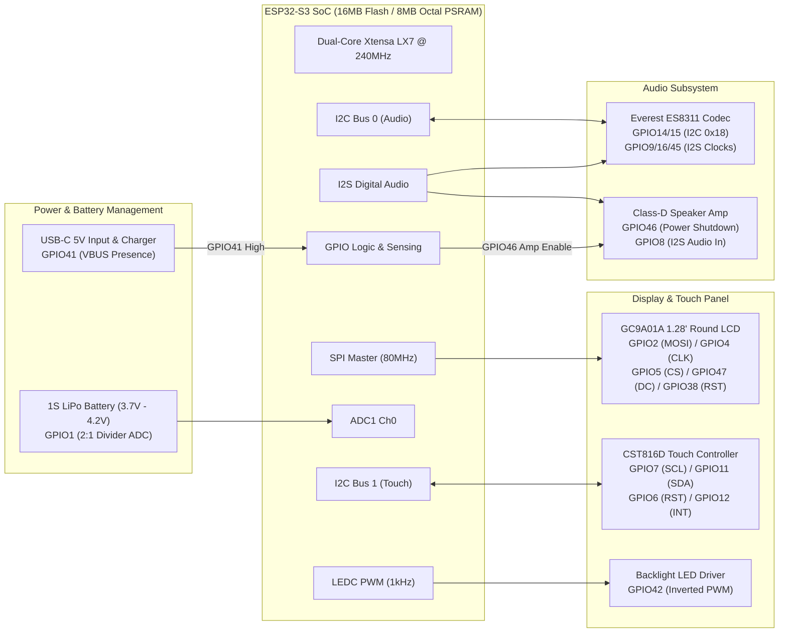

# 🔬 Hardware Technical Reference & Pinout

This document provides a technical overview of the **SP-ESP32-S3-1.28-BOX** hardware, reverse-engineered pin mappings, and integration details.

---

## 📦 Device Overview

* **Original Product:** [ESP32-S3 1.28" Round Display Box on AliExpress](https://it.aliexpress.com/item/1005008821384965.html)
* **Factory Stock Firmware:** [xiaozhi-esp32 on GitHub (78/xiaozhi-esp32)](https://github.com/78/xiaozhi-esp32)
* **Microcontroller:** Espressif ESP32-S3 (Dual-core Xtensa LX7 @ 240MHz)
* **Flash & PSRAM:** 16MB Flash / 8MB Octal SPI PSRAM (@ 80MHz)
* **Display:** 1.28-inch IPS circular TFT LCD (240x240 resolution)
* **Display Driver:** GC9A01A (SPI bus @ 80MHz)
* **Touch Panel:** CST816D capacitive touch controller (I2C)
* **Audio Codec / DAC:** Everest ES8311 (I2C configuration + I2S digital audio)
* **Power & Battery:** Integrated 1S LiPo battery, USB-C charging, ADC battery voltage divider, and hardware charging detection

---

## 🗺️ Hardware Architecture Block Diagram



---

## 📌 Complete GPIO Pinout Table

> [!WARNING]
> **Board Revisions Notice:** AliExpress vendors and clones occasionally update PCB revisions or route pins slightly differently (e.g., audio amplifier enable on GPIO46 vs GPIO48, or touch interrupt). The pinout documented below is tailored for the **SP-ESP32-S3-1.28-BOX**. Always verify your board's silkscreen markings or test with a multimeter if a specific peripheral does not initialize on your unit.

| GPIO Pin | Function | Subsystem | Notes |
| :--- | :--- | :--- | :--- |
| **GPIO1** | ADC1 Channel 0 | Battery Monitor | Connected to 2:1 resistor divider. Voltage range: 3.3V (0%) - 4.2V (100%). |
| **GPIO2** | SPI MOSI | Display (GC9A01A) | Data transmission to round LCD. |
| **GPIO4** | SPI CLK | Display (GC9A01A) | Clock boosted to 80MHz (optimized SPI throughput). |
| **GPIO5** | SPI CS | Display (GC9A01A) | Chip Select (Active LOW). |
| **GPIO6** | Touch Reset | Touchscreen (CST816D) | Hardware reset line. |
| **GPIO7** | I2C SCL (Touch) | Touchscreen (CST816D) | Dedicated Touch I2C bus clock. |
| **GPIO8** | I2S DOUT | Audio Speaker | Serial audio data to internal amplifier / DAC. |
| **GPIO9** | I2S BCLK | Audio Codec (ES8311) | Bit clock for I2S audio stream. |
| **GPIO11** | I2C SDA (Touch) | Touchscreen (CST816D) | Dedicated Touch I2C bus data. |
| **GPIO12** | Touch INT | Touchscreen (CST816D) | Interrupt signal triggered by touch events. |
| **GPIO14** | I2C SCL (Audio) | Audio Codec (ES8311) | Codec control bus clock. |
| **GPIO15** | I2C SDA (Audio) | Audio Codec (ES8311) | Codec control bus data (Address: `0x18`). |
| **GPIO16** | I2S MCLK | Audio Codec (ES8311) | Master clock output to the ES8311. |
| **GPIO38** | LCD Reset | Display (GC9A01A) | Display hardware reset line. |
| **GPIO41** | Digital Input | Charging Sensor | Logic HIGH when connected to USB-C 5V power. |
| **GPIO42** | LEDC PWM | Display Backlight | Active LOW (requires `inverted: true`). Frequency: 1000Hz. |
| **GPIO45** | I2S LRCLK | Audio Codec (ES8311) | Left/Right word select clock (strapping pin ignored in config). |
| **GPIO46** | Digital Output | Audio Amplifier Power | Enables onboard speaker amplifier (Active HIGH). |
| **GPIO47** | LCD DC | Display (GC9A01A) | Data / Command control pin. |

---

## ⚡ Power Management & Battery Sensing

### 1. Battery Voltage ADC (GPIO1)
The device includes an onboard resistor divider (typically 100kΩ / 100kΩ, giving a 2:1 division ratio) connected to `GPIO1`:
* **Attenuation:** 12dB (allows reading up to ~3.1V on the ADC pin).
* **Multiplication:** Filter `multiply: 2.0` restores the true battery rail voltage.
* **Filtering:** `median: window_size: 5` eliminates noise spikes caused by Wi-Fi bursts.
* **Calibration Curve:** 
  $$\text{3.3V} \longrightarrow 0\%$$
  $$\text{4.2V} \longrightarrow 100\%$$

### 2. Charging Detection (GPIO41)
`GPIO41` is wired to the VBUS line of the USB-C power circuitry:
* **State `ON`:** Connected to USB-C charger. The display backlight stays active, sleep timer is suspended, and the device operates in desktop clock mode.
* **State `OFF`:** Running on internal battery. Backlight automatically fades to black after the configured `sleep_timeout` (default: 300s) to conserve power.

### 3. Dynamic Amplifier Power (GPIO46)
The audio amplifier on `GPIO46` is managed dynamically:
* In standby, `audio_amp` is set to `OFF`, saving **15–25 mA** of quiescent current and eliminating idle hiss.
* When Home Assistant initiates a TTS message, `audio_amp` is immediately enabled.
* After the audio stream finishes, a 1-second delay ensures speech reverberation is not clipped before powering down the amplifier.

---

## 📡 Bluetooth Proxy Architecture & Supported Peripherals

The device's built-in 2.4GHz radio is configured as an ESPHome **passive Bluetooth Proxy**:

### General BLE Compatibility
* **Smart Lights & Bulbs:** Philips Hue BLE, Yeelight, and Tuya Bluetooth lamps.
* **Environmental & Climate Sensors:** Xiaomi Mijia (LYWSD03MMC), Qingping, ThermoPro, BTHome v1/v2 sensors.
* **Security & Automation:** Shelly BLU door/window contacts, Shelly BLU motion sensors, SwitchBot motors.
* **Beacons & Trackers:** iBeacon presence tags and smartwatch proximity broadcasts.

---

## 🔄 Factory Firmware Backup & Recovery

If you ever wish to back up the original stock firmware (`xiaozhi-esp32`) before flashing, or restore it later, use `esptool.py`:

### Backup Stock Firmware (16MB Flash)
```bash
esptool.py --port COM_PORT --baud 921600 read_flash 0 0x1000000 stock_xiaozhi_backup.bin
```

### Restore Stock Firmware
```bash
esptool.py --port COM_PORT --baud 921600 write_flash 0 stock_xiaozhi_backup.bin
```

*(Replace `COM_PORT` with your device's serial port, e.g. `COM5` on Windows or `/dev/ttyACM0` on Linux).*

