# ⚡ Quickstart Guide: Flash & Use in 3 Minutes

Turn your AliExpress **ESP32-S3 1.28" Round Display Box** into a **Home Assistant Smart Desktop Display** in three simple steps.

---

## 🔄 How It Works at a Glance

```mermaid
sequenceDiagram
    autonumber
    actor User as 👤 You
    participant HA as 🏠 Home Assistant
    participant ESP as 🔮 MiniDisplay (ESP32-S3)
    participant LCD as 🎨 1.28" Round LCD
    participant Audio as 🔊 ES8311 Speaker

    Note over HA,ESP: Idle Standby (Always-on when plugged into USB-C)
    HA->>ESP: Sync SNTP Time & Live Weather
    ESP->>LCD: Display Standby Clock + Outdoor Weather & Temp

    rect rgb(30, 42, 56)
    Note over HA,ESP: Automation Trigger (Doorbell / Appliance / Leaks)
    HA->>ESP: Call esphome.minidisplay_send_notification
    par Visual Alert
        ESP->>LCD: Wake / Fade on backlight (LEDC PWM)
        ESP->>LCD: Display notification icon, colored text & counter
    and Audio Alert (Optional)
        HA->>Audio: Play TTS voice announcement or chime
    end
    end

    Note over User,LCD: Interactive Touch Navigation
    User->>LCD: Swipe Left / Right (Browse 10-card history)
    User->>LCD: Swipe Down (Confirm & clear all notifications)
    User->>LCD: Long Press (View Wi-Fi, IP & Battery diagnostics)
```



---

### Step 1: Get the Hardware
* **Hardware Device:** [ESP32-S3 1.28" Round Display Box on AliExpress](https://it.aliexpress.com/item/1005008821384965.html)
* **What you get:** ESP32-S3 (8MB PSRAM), 1.28" 240x240 circular IPS screen, CST816D capacitive touch, ES8311 audio DAC, speaker, LiPo battery, and a clean desktop enclosure with USB-C.

---

### Step 2: Configure & Flash with ESPHome

#### Option A: Copy & Paste in ESPHome Dashboard (Easiest)
1. Open your **ESPHome Dashboard** in Home Assistant.
2. Click **+ New Device** in the bottom-right corner.
3. Choose a name (e.g., `minidisplay`) and skip the wizard.
4. Click **Edit** on the newly created device card.
5. Replace everything with the full content of [`minidisplay_standalone.yaml`](../minidisplay_standalone.yaml).
6. Customize the top `substitutions:` with your local settings:
   ```yaml
   substitutions:
     device_name: "minidisplay"
     friendly_name: "MiniDisplay"
     timezone: "Europe/Rome"
     weather_entity: "weather.forecast_casa" # Change to your HA weather entity (e.g. weather.home)
     sleep_timeout: "300s"                   # Auto screen-off when on battery
   ```
   > [!NOTE]
   > **Weather Entity:** If you don't know your weather entity ID, check **Developer Tools > States** in Home Assistant and search for `weather.`. If your entity is named differently (e.g., `weather.home`), change it above. If Home Assistant is offline, the clock will cleanly show `--°C` without crashing.

7. Ensure your Wi-Fi credentials exist in your `secrets.yaml`:
   ```yaml
   wifi_ssid: "YOUR_WIFI_SSID"
   wifi_password: "YOUR_WIFI_PASSWORD"
   ```
8. Connect the display via USB-C to your computer (using Chrome or Edge).
9. Click **Install** -> **Plug into this computer** to flash directly from your browser!

#### Option B: Modular Packages (Recommended for Git / Power Users)
1. Copy the [`packages/`](../packages/) folder and [`minidisplay.yaml`](../minidisplay.yaml) into your Home Assistant `/config/esphome/` directory.
2. Open ESPHome Dashboard, click **Install**, and flash.

---

### Step 3: Send Your First Notification!

Once booted and connected to your Wi-Fi, Home Assistant will automatically discover the device.

Go to **Developer Tools** -> **Actions** (or Services) in Home Assistant and run:

```yaml
action: esphome.minidisplay_send_notification
data:
  message: "Washing machine cycle finished!"
  icon: "home"
  text_color: "cyan"
  timeout: 30
```

The screen will wake up, smoothly fade on, and display your notification card!

---

### Gestures Cheat Sheet

| Gesture | Action |
| :--- | :--- |
| **Swipe Down** (from clock) | Open Notification History (LIFO queue) |
| **Swipe Left / Right** | Browse previous / next notification |
| **Swipe Up** | Return to the Clock & Weather Home page |
| **Swipe Down** (in notifications) | Open confirmation modal to clear all notifications |
| **Double Tap** | Toggle display backlight On / Off |
| **Long Press** (on clock) | Open Hardware & Diagnostic Debug screen |

