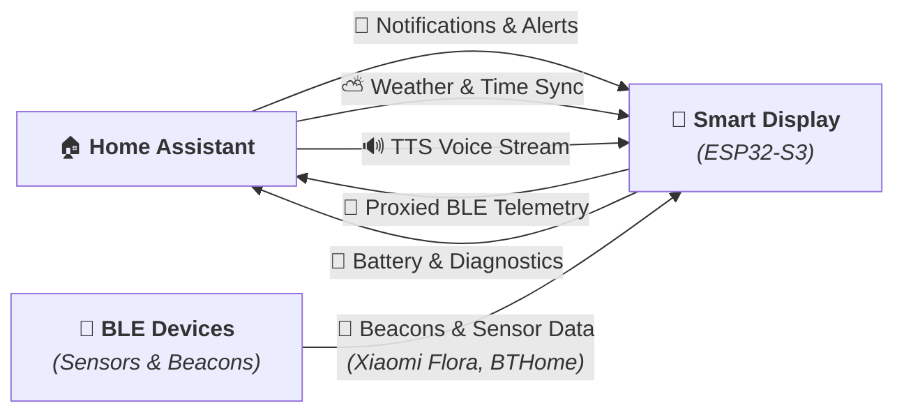

# 🔮 Welcome to the SmartDisplay Wiki

**SmartDisplay** is an open-source, modular firmware based on **ESPHome** and **LVGL 8** designed for the **SP-ESP32-S3-1.28-BOX** circular smart display.

It repurposes the popular AliExpress [Xiaozhi AI desktop box](https://it.aliexpress.com/item/1005008821384965.html) into a **100% local, private, full-featured Home Assistant notification display, desktop clock, weather widget, and TTS voice announcement speaker**.

---

## 🧭 Wiki Navigation

* **[⚡ Quickstart Guide](Quickstart)** — How to configure and flash your SmartDisplay in under 3 minutes.
* **[🔬 Hardware & Pinout Reference](Hardware-and-Pinout)** — Complete 19-GPIO table, power circuitry, board revisions warning, and stock firmware backup.
* **[🏠 Home Assistant Integration](Home-Assistant-Integration)** — Action calls, automations, visual blueprint, and TTS announcements.
* **[📡 Bluetooth Proxy & Plant Care](Bluetooth-Proxy)** — How to monitor Xiaomi Mi Flora sensors and BTHome beacons with passive BLE.
* **[❓ Troubleshooting & FAQ](Troubleshooting)** — Common issues, Wi-Fi recovery, and circular UI clipping tips.

---

## 🗺️ System Architecture

---

## 🛒 Hardware Compatibility

| Component | Specification |
| :--- | :--- |
| **SoC** | Espressif ESP32-S3 (Dual-core 240MHz, 16MB Flash, 8MB Octal PSRAM) |
| **Display** | 1.28-inch circular IPS LCD (240x240, GC9A01A over 80MHz SPI) |
| **Touch** | CST816D capacitive touch controller (I2C) |
| **Audio** | Everest ES8311 DAC + onboard speaker with GPIO46 power gating |
| **Power** | 1S LiPo battery + USB-C charging + GPIO1 battery ADC + GPIO41 charging sensor |
